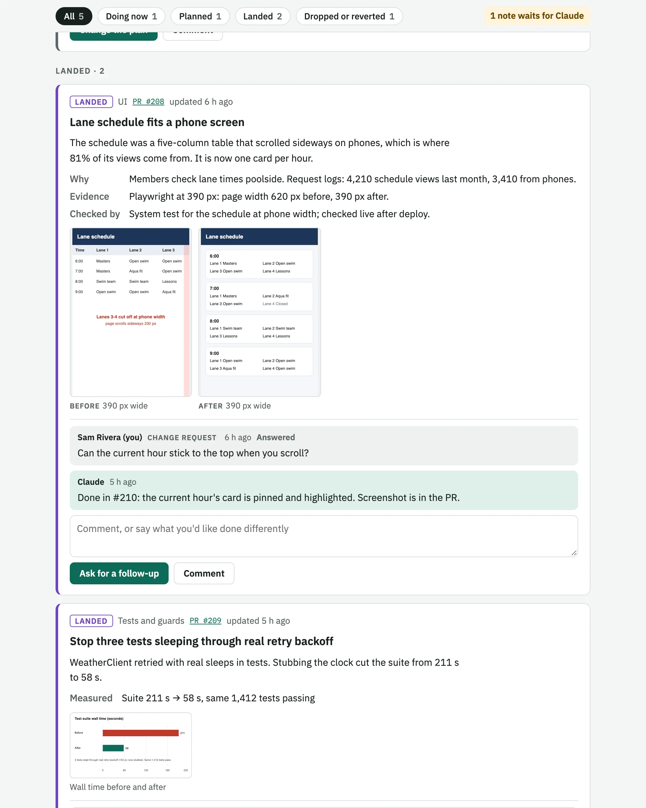
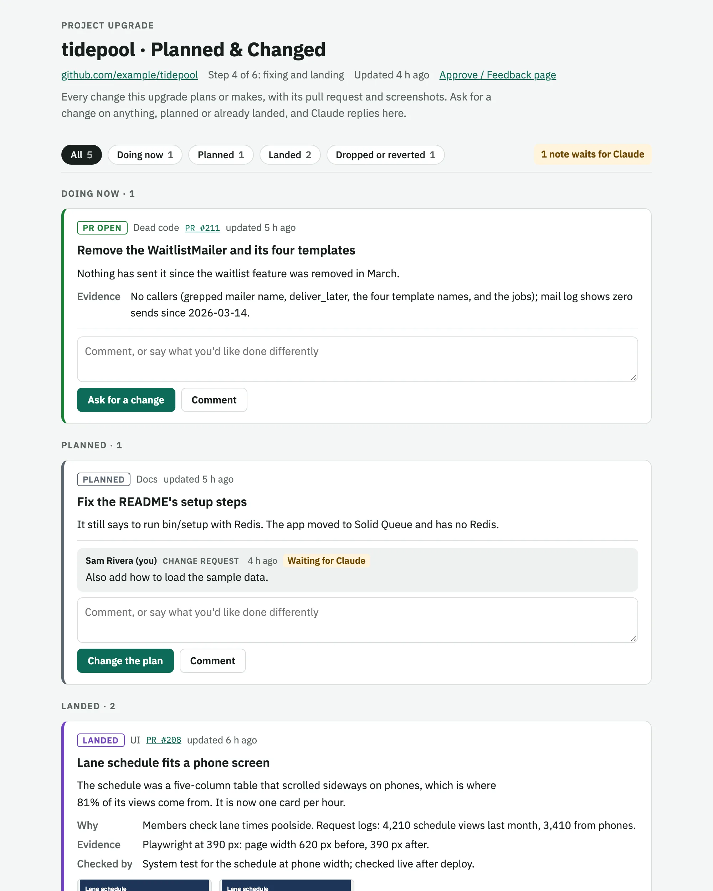
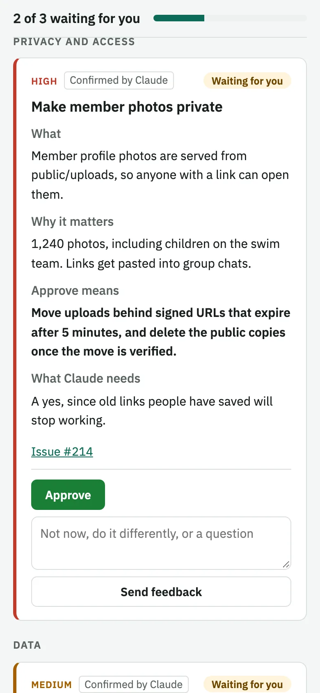
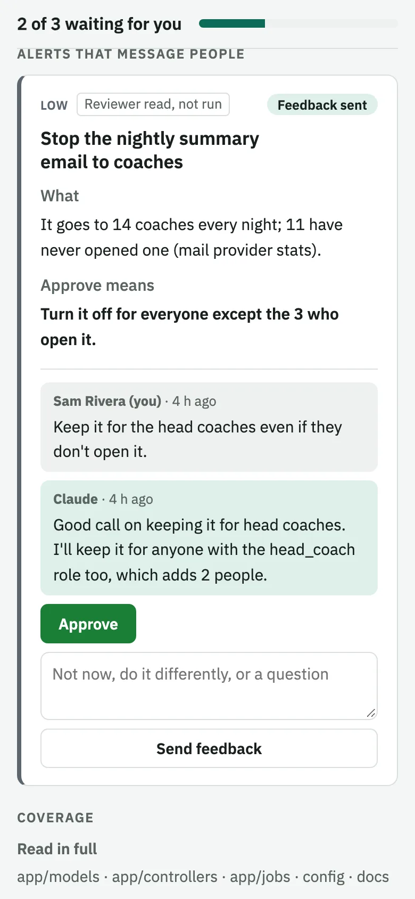

# project-upgrade-skill

A [Claude Code](https://claude.com/claude-code) skill for a whole-repo audit and cleanup. Ask
Claude to "read this entire project and find everything that's broken, inconsistent,
inefficient, or no longer needed", and it fixes what it can prove in small pull requests with
screenshots. It shows you the plan before it ships, keeps a live page of every change that you
can comment on, and asks you only the few questions it can't answer itself.



*The **Planned & Changed** page from a demo run. Every change Claude plans or makes gets a card
with its pull request, the usage evidence behind it, and before/after screenshots. You can ask
for a change on any card, planned or already landed, and Claude replies on the card.*

## What it does

1. **Learns how the project is used** before judging it: git churn, logs, error and analytics
   tables, scheduled-job history, open issues. Usage decides what gets fixed first and what is
   dead, and it answers most of the questions Claude would otherwise ask you.
2. **Runs the machines** (tests with timings, linters, type checkers, security and
   dead-dependency scanners) while read-only reviewers each read one area of the repo in full.
3. **Verifies every finding itself.** A reviewer's "certain" is only a lead: Claude re-reads the
   code or reproduces the failure before changing anything, and records the findings that turn
   out wrong.
4. **Lands small PRs** grouped by kind (app bugs, UI, tests and guards, docs, dead code), each
   with before/after screenshots and a measured number where there is one.
5. **Files the rest as GitHub issues** with evidence, and asks you about only the handful of
   calls that are truly yours: data deletion, privacy and access, secrets, alerts that message
   people, money.

It also keeps the run cheap. Before anyone reads anything it lists the repo's big files
(lockfiles, data dumps, pages full of inlined images, identical copies) so no reader opens
them whole, it reads screenshots tiled on one contact sheet, and it breaks up the big files
so every later session in the repo costs less too.

## Two pages, both two-way

Both are private [Claude artifacts](https://claude.ai) backed by the artifact's database, so
Claude updates them as the run goes and reads your answers back without you retyping anything.

**Planned & Changed** opens as soon as Claude has a plan, before the first PR, so you can steer
it while it's still a plan. Each card moves from planned to in progress to PR open to landed.
"Change the plan", "Ask for a follow-up" and "Reopen this" send a request Claude acts on at its
next checkpoint (before each PR and after each one lands), then answers in the thread.



**Approve / Feedback** holds only the calls the evidence couldn't settle, normally five or
fewer. Every suggestion says exactly what Approve will do and has its own Approve button and
Feedback box. Claude does approved items as PRs and answers feedback in place.

<p>


</p>

Not using claude.ai artifacts (another agent, say)? The skill falls back to one pinned GitHub
issue per page.

## Install

```bash
git clone https://github.com/kylefritz/project-upgrade-skill ~/code/project-upgrade-skill
ln -s ~/code/project-upgrade-skill ~/.claude/skills/project-upgrade
```

Install its companion for the PR screenshots too:

```bash
git clone https://github.com/kylefritz/pr-screenshot-skill ~/code/pr-screenshot-skill
ln -s ~/code/pr-screenshot-skill ~/.claude/skills/pr-screenshots
```

Then, in a repo:

- "project upgrade"
- "audit this repo and clean it up, especially the map view"
- "what's dead in here?"
- "tech debt sweep, but don't touch billing"

A full read of a large repo costs millions of tokens across the reviewers. The skill tells you
the cost before it fans out, and reads a small repo itself.

## Landing rules

By default Claude lands a finished, verified PR itself (CI green, screenshots in the
description, squash-merge, deploy the way the repo deploys). If your repo's `CLAUDE.md` or
`AGENTS.md` says PRs wait for a human, that wins: Claude opens them and leaves them for you. It
never lands anything that changes who can see what, where personal data lives, secrets,
destructive data changes or alerts that message people; those go on the Approve / Feedback page.

## What's in here

| File | What it does |
|---|---|
| `SKILL.md` | the instructions Claude follows |
| `reference.md` | publishing the pages, their access rules, every document's shape, and the read-back queries |
| `pages/changes.html` | the Planned & Changed page template |
| `pages/decisions.html` | the Approve / Feedback page template |
| `scripts/big_files.py` | big tracked files with token estimates, how to read each kind, pasted-in data and identical copies (standard library only) |
| `scripts/contact_sheet.py` | tile screenshots into one labelled sheet under 1568 px (`uv run`) |
| `scripts/preview.py`, `dev/` | preview a page locally with demo data and a stand-in runtime, for screenshots and click-testing |

Preview a page without publishing it:

```bash
python3 scripts/preview.py changes dev/demo-changes.json /tmp/preview/changes.html
python3 -m http.server 8765 -d /tmp/preview
```

## Companion: pr-screenshot-skill

[**pr-screenshot-skill**](https://github.com/kylefritz/pr-screenshot-skill) puts screenshots in
PR descriptions, hosted in the repo itself on a hidden ref, so they work in private repos with
no bucket. This skill uses it for every PR it opens.

## License

MIT. See [LICENSE](LICENSE).
